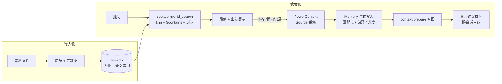

# 拾遗 · 学习资料库 + 个性化复习助手 — PRD

> OceanBase 2026 大赛 · Qoder 赛道（Build with Qoder）
> 主题：让学习更高效。核心功能由 seekdb（检索）与 PowerContext（记忆）共同承担。

---

## 1. 痛点

学习资料散落在课件 PDF、笔记 Markdown、实验记录里。两个高频低效场景：

1. **找不到**：「我肯定看过这段，但想不起来在哪个文件」——文件夹搜索只认关键词，不认语义。
2. **不知道自己哪里弱**：复习凭感觉，错过已暴露的薄弱点；上次不会的问题，这次还是不会。

## 2. 产品定义

一句话：**把学习资料导入 seekdb 变成可语义检索的知识库，把学习行为写进 PowerContext 变成跨会话的复习状态。**

| # | 功能 | 说明 | 承担技术 |
|---|------|------|----------|
| F1 | 资料导入 | 上传/指定 pdf、md、txt；切块、向量化、建全文索引；元数据含来源文件名、课程标签、导入时间 | seekdb |
| F2 | 检索问答 | 自然语言提问 → 混合检索（向量 + 全文 + 元数据过滤）→ 返回相关段落 + 出处（文件名/位置） | seekdb |
| F3 | 复习记忆 | 「不懂/已掌握」标记与提问历史写入 PowerContext；下次启动召回，生成「优先复习」建议；重启后不丢 | PowerContext |

**明确不做**（控范围，保证完成度）：

- 多用户/账号体系（单机单用户，scope 固定）
- 云端部署（本地运行，Sites 只放展示站）
- 依赖 LLM API 的回答生成（见 §5，作为可选增强，默认关闭）

## 3. 双技术分工（题面硬要求：同时使用时必须说明）



- **seekdb = 知识检索核心**。所有资料内容只存 seekdb；检索必须走 `hybrid_search`（向量语义 + `$contains` 全文 + 元数据过滤），返回段落和出处。检索调用参数与返回（ids、distances、documents）记录成日志，作为「技术结合有效」的核对证据。
- **PowerContext = 学习者状态核心**。每次提问写入 Source；「不懂」标记触发显式 Memory 写入（kind/fact/text/reason）；应用启动与每次提问前调 `context/prepare`，将召回内容注入复习建议区。写入与召回的 scope_id、返回的 artifact 地址记录成日志。
- 两者**无数据重复**：资料在 seekdb，学习者状态在 PowerContext。

## 4. 关键设计决策

### 4.1 核心闭环不依赖 LLM API

题面参考方向是「快速找到相关段落和出处」——检索型即可满足。若答案生成依赖模型 API，评审复现时没有 key 就跑不起来，直接威胁「能运行」验收。

决策：**F1/F2/F3 全部不调用任何 LLM**。可选增强（默认关闭）：配置 `OPENAI_BASE_URL/OPENAI_API_KEY` 后，把检索段落拼进 prompt 生成一段摘要回答；未配置时 UI 明确显示「未启用模型，仅检索模式」。配置一律占位值。

### 4.2 嵌入模型本地化（无 API key）

seekdb 默认嵌入 `sentence-transformers/all-MiniLM-L6-v2`（ONNX，384 维，本地推理）。两个已验证的环境坑：

1. **模型下载**：hf-mirror.com 会把文件 308 重定向到 huggingface.co（大陆直连失败）。运行说明必须包含模型种子步骤：从 ModelScope（`AI-ModelScope/all-MiniLM-L6-v2`）下载 6 个文件到 `~/.cache/pyseekdb/onnx_models/all-MiniLM-L6-v2/onnx/`。仓库附 `scripts/seed_model.sh`。
2. **批量写入超时**：批量 `add` 冷启动可能超过默认 10s 语句超时（ob_query_timeout）。导入按 ≤8 条一批切片写入，失败重试一次。

### 4.3 PowerContext 召回是全文匹配，素材要可命中

未配置推理模型时 `context/prepare` 走全文检索（已验证：query 含「写放大 复习」能召回含该词的 Memory）。因此 Memory 文案规则：**每条 Memory 的 text 必须包含可检索的实体词**（知识点名），避免只有抽象描述。这是提示词里要写明的约束。

### 4.4 持久化与「重启复用」演示

- seekdb embedded：数据落 `./data/seekdb`（Client 指定 path），重启不丢。
- PowerContext server：默认 SQLite，scope 用固定 `idempotency_key` 重建，Memory 持久（已验证跨重启召回）。
- 验证样例中「重启进程 → 复习建议仍在」是「状态能复用」的核对点。

## 5. 架构

```
studydesk/                      # qoder/<项目目录>，Qoder 开发
├── app/
│   ├── main.py                 # FastAPI 入口
│   ├── ingest.py               # 解析/切块/写入 seekdb
│   ├── search.py               # hybrid_search 封装 + 检索日志
│   ├── memory.py               # PowerContext client（stdlib urllib 即可）
│   └── web/                    # 静态页（单页即可）
├── sample_data/                # 验证样例用的 3 个资料文件（仓库自带）
├── scripts/
│   ├── seed_model.sh           # ModelScope 模型种子
│   └── run_verify.sh           # 验证样例一键脚本
├── data/                       # 运行时生成（gitignore）
├── logs/                       # 检索日志 / 记忆日志（gitignore 样例，样例输出入库）
├── requirements.txt
└── README.md                   # 运行说明 + 验证样例（评审入口）
```

技术栈约束（给 Qoder 的边界）：Python 3.12、FastAPI + uvicorn、pyseekdb（embedded）、PowerContext HTTP API（不引 SDK 也行，stdlib）、前端无框架单页（或 Jinja2）。不引 Docker（评审环境复杂度+）。

### 接口形状（供 Qoder 拆解，实现细节它定）

| 端点 | 行为 |
|---|---|
| `POST /ingest` | body: `{paths: [...], course: "..."}` → 入库，返回每文件 chunk 数 |
| `GET /search?q=&course=` | hybrid 检索 → `[{doc_id, text, source_file, distance, matched_by}]` + 写检索日志 |
| `POST /feedback` | body: `{doc_id, verdict: "weak"\|"mastered", note}` → Source + Memory 写入，返回 artifact 地址 |
| `GET /review` | `context/prepare` → `{status, suggestions: [...], raw_content}` + 写记忆日志 |
| `GET /` | 单页 UI：导入区 / 提问区 / 出处列表 / 复习建议区 |

PowerContext 调用（已在本机 1.4.1 验证）：

```text
POST /v1/scopes            {"title","summary","idempotency_key":"studydesk"} → scope_id
POST /v1/sources/content   {"scope_id","source_id","content","metadata"}
POST /v1/memory/remember   {"scope_id","kind","text","reason"} → records[].artifact
POST /v1/context/prepare   {"scope_id","query","max_bytes":4000} → {status, content}
```

seekdb 调用（pyseekdb 1.4.0.post1 embedded 已验证）：

```python
client = pyseekdb.Client()          # embedded；数据目录用 path 指定以便持久化
col = client.create_collection(name="studydesk")
col.add(ids, documents, metadatas)  # 自动向量化；≤8 条/批
col.hybrid_search(
    query={"where_document": {"$contains": kw}, "n_results": 5},
    knn={"query_texts": [q], "n_results": 5},
    rank={"rrf": {}}, n_results=3, include=["documents", "metadatas"],
)
```

## 6. 验证样例（提交材料之一，最终版随 README 交付）

| 步骤 | 操作 | 预期 | 证据 |
|---|---|---|---|
| S1 | `bash scripts/seed_model.sh && pip install -r requirements.txt && python -m app.main` | 服务起在 127.0.0.1:8001 | 终端输出 |
| S2 | `POST /ingest` 导入 `sample_data/` 3 个文件 | 返回每文件 chunk 数 >0 | 响应 JSON |
| S3 | `GET /search?q=写放大` | 第一条含「写放大」段落 + 出处文件名 | 响应 + `logs/search_*.json` |
| S4 | `POST /feedback` 标记 weak | 返回 Memory artifact 地址 | 响应 + `logs/memory_*.json` |
| S5 | **重启进程** → `GET /review` | suggestions 含 S4 的知识点；`status: ready` | 响应 + 日志 |
| S6 | 无痕浏览器打开 Qoder Sites 展示站 | 未登录可访问 | 截图 |

## 7. 风险与对策

| 风险 | 对策 |
|---|---|
| 评审环境无 HF 访问，模型下不来 | seed 脚本走 ModelScope；README 置顶 |
| 中英文混合检索质量（MiniLM 英文为主） | 样例数据含中文场景已验证可命中；`$contains` 全文兜底关键词 |
| 端口冲突（PowerContext 8000） | 应用用 8001，README 写明两个端口 |
| 评审没配 PowerContext | README 的启动步骤含 `powercontext server run`；应用启动时探测并给出明确报错 |
| 范围膨胀做不完 | §2 不做清单是硬边界；M1→M5 顺序交付 |

## 8. 里程碑（对应 QODER-PROMPTS.md 的阶段）

M1 骨架 + seekdb 导入/检索 → M2 Web UI → M3 PowerContext 记忆闭环 → M4 样例脚本 + README → M5 Sites 展示站。每个里程碑交付可运行增量，Qoder 对话记录按阶段留存。
